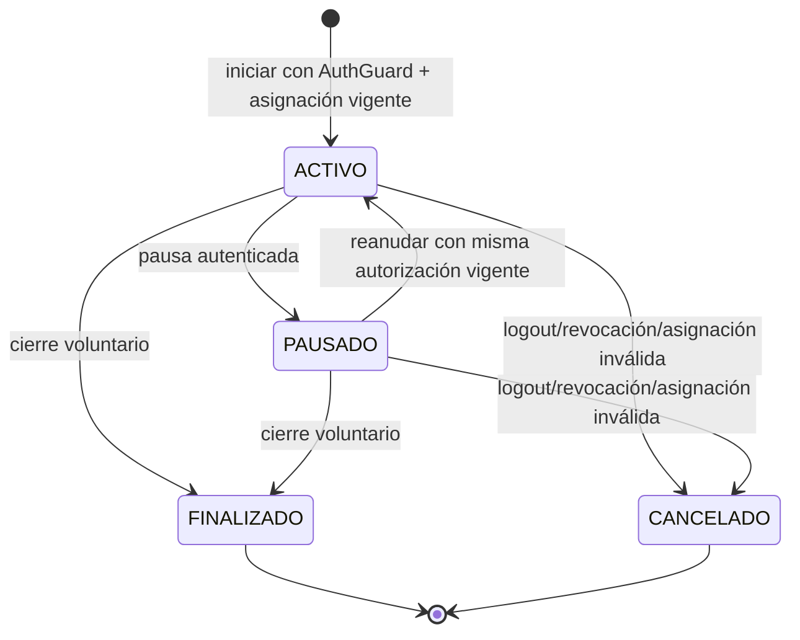

# Diseño propuesto: ingesta GPS autenticada y acotada

Estado: **solo diseño; no habilita endpoints ni autoriza cambios de SQL, ACL o despliegue.** Fecha: 2026-10-16. La única modificación local previamente autorizada en el SQL oficial (`fn_notify_realtime`) se conserva; no se considera validada funcionalmente.

Las etiquetas **Hecho** y **Propuesta** distinguen evidencia del árbol frente a decisiones futuras. Las rutas y respuestas de ejemplo son propuestas explícitas, no contratos HTTP existentes.

## 1. Lo que ya existe

### Identidad y sesión HTTP

- **Hecho:** `POST /auth/sessions` autentica con correo, contraseña, `deviceId` y `deviceToken` (`src/auth/auth.controller.ts`, `src/auth/auth.dto.ts`, `src/auth/auth.service.ts`). Se comprueban contraseña y hash del token del dispositivo; `OpaqueTokenService` emite 32 bytes aleatorios y guarda SHA-256. El token de dispositivo se usa junto con credenciales de usuario para login. No se usa para firmar cada posición ni hay contrato que lo defina como credencial GPS.
- **Hecho:** el access token es JWT HS256, audiencia `dercas-client`, expiración de 15 minutos, con `sub`, `sid`, `did` y `jti`. `AuthGuard` valida firma y vuelve a consultar en PostgreSQL sesión, usuario, dispositivo y permisos efectivos en cada petición.
- **Hecho:** `POST /auth/sessions/logout` cierra la sesión de dispositivo; su trigger actual sincroniza `dispositivos.autenticado`. No cierra sesiones GPS.
- **Hecho:** todas las rutas actuales `/gps` son GET. No hay ruta de start, ingest, pause, finish ni revoke. `GpsModule` comenta expresamente que no debe habilitarse ingesta pública hasta aprobar identidad, autorización, ámbitos, retención y límites.

### Asignaciones y sesión GPS

- **Hecho:** `asignaciones_vehiculo` registra `piloto_id`, `vehiculo_id`, estado, inicio y fin; hay una asignación activa única por piloto y por vehículo. No existe endpoint de escritura de asignación en este módulo.
- **Hecho:** `sesiones_seguimiento` guarda dispositivo, usuario, vehículo, movimiento opcional, perfil, `habilitado_por_id`, estado (`ACTIVO`, `PAUSADO`, `FINALIZADO`, `CANCELADO`) y fechas inicio/fin. Tiene un índice único parcial para una fila `ACTIVO` por dispositivo, pero no tiene vencimiento ni contador monotónico.
- **Hecho:** `posiciones_gps` es mensual por `fecha_hora_servidor`, con partición DEFAULT; contiene `sesion_seguimiento_id`, `dispositivo_id`, `uuid_operacion`, `fecha_hora_dispositivo`, coordenadas y campos asociados. Su unicidad SQL es `(uuid_operacion, fecha_hora_servidor)`, no UUID global.
- **Hecho:** `GpsPositionRepository.insert()` acepta `sessionId`, `deviceId`, coordenadas, `capturedAt` y `operationId`; no acepta `vehicleId`. Usa lock transaccional `pg_advisory_xact_lock` por UUID, busca duplicados y devuelve el registro previo si el payload coincide; UUID con otro payload genera conflicto. El registro utiliza valores enlazados. El repositorio no valida AuthPrincipal, propietario de sesión, vigencia de sesión HTTP, asignación actual ni el permiso de reportar ubicación.
- **Hecho:** el trigger BEFORE `fn_validar_posicion_gps` exige que exista la sesión GPS, que el dispositivo coincida y que su estado sea `ACTIVO`; deriva usuario/vehículo/movimiento desde la sesión cuando los campos están nulos. No valida por sí solo que la sesión HTTP pertenezca a ese usuario ni que el vehículo siga asignado.
- **Hecho:** el trigger AFTER `fn_actualizar_ultima_posicion_gps` hace upsert del snapshot y actualiza `dispositivos.ultima_posicion_at`, batería, tracking y `updated_at`. `fn_notify_realtime` publica un payload genérico `table, operation, id, timestamp`; el backend WebSocket/MQTT está mencionado en un comentario SQL, pero no se encontró consumidor en el repo.
- **Hecho:** ninguna función de trigger está declarada `SECURITY DEFINER` en el SQL inspeccionado; por tanto, las escrituras secundarias requieren privilegios efectivos de la identidad que ejecuta la operación. El cambio local de `fn_notify_realtime` para mapear `ultima_posicion_gps` a `dispositivo_id` aún no ha pasado una escritura positiva.

### Clientes y política de producto

- **Hecho:** no se encontró código de aplicación móvil, firmware, SDK GPS ni documento que defina el protocolo de posiciones o credenciales de dispositivo. El SQL contiene `dispositivos.plataforma` con default `ANDROID`, lo cual no demuestra qué clientes existen.
- **Hecho:** `docs/DERCAS_Especificacion_UI_UX_y_Prompts(1).md` dice que no se agregue GPS permanente ni rutas en vivo; limita ubicación a emergencias cuando haya permiso y disponibilidad. Esto contradice una sesión de seguimiento con transmisión continua. Resolverlo con el responsable de producto antes de convertir este diseño en requisito.

### Alcance GPS permitido por la especificación vigente

- En `docs/DERCAS_Especificacion_UI_UX_y_Prompts(1).md:45` se prohíben expresamente GPS permanente y rutas en vivo; la ubicación solo aparece puntualmente en emergencias, si existe permiso y disponibilidad.
- En `docs/DERCAS_Especificacion_UI_UX_y_Prompts(1).md:444` se limita la solicitud de ubicación a activar una emergencia y se prohíben el rastreo permanente y el recorrido GPS.
- En `docs/DERCAS_Especificacion_UI_UX_y_Prompts(1).md:658` la ayuda debe explicar que no existe seguimiento permanente de ubicación.

Estas referencias distinguen alcances funcionales que no son intercambiables:

1. **Ubicación puntual bajo demanda:** una lectura aislada asociada a una acción del usuario. La especificación solo autoriza expresamente mostrarla al activar una emergencia; no autoriza una consulta genérica de ubicación ni un historial.
2. **Seguimiento temporal autorizado:** una serie limitada de posiciones bajo una sesión, propósito, inicio y fin explícitos. Es distinto de una lectura aislada y distinto de rastreo continuo permanente. La especificación UI/UX no lo autoriza actualmente; requeriría decisión de producto, alcance, duración, consentimiento y reglas de cierre.
3. **Transmisión continua o en vivo:** envío sostenido de posiciones y presentación de recorridos/localización en tiempo real. Está prohibido por las referencias anteriores mientras esa especificación siga vigente.

Por tanto, lo permitido comprobablemente hoy es ubicación puntual en el flujo de emergencia, condicionada a permiso y disponibilidad. No se habilita registro GPS bajo demanda fuera de ese contexto, una sesión de seguimiento temporal ni transmisión continua. El contrato de ingesta, los endpoints candidatos y la máquina de estados más adelante en este documento son propuestas de diseño sin autorización funcional; no deben interpretarse como requisitos vigentes. La decisión pendiente es si producto mantiene solo el caso de emergencia puntual o aprueba un alcance temporal nuevo con restricciones concretas. Hasta esa decisión, no implementar ingesta ni crear rutas.

## 2. Contrato HTTP candidato (propuesto, no existente)

La identidad de cada llamada sería el principal del access token existente: `userId=sub`, `authSessionId=sid`, `deviceId=did`. No se aceptan `userId`, `deviceId` ni `vehicleId` del cliente como autoridad. Se requiere HTTPS. No se reutiliza `deviceToken` como secreto GPS ni se expone `device_token_hash`.

### Solicitar inicio

Ruta candidata: `POST /gps/me/sessions`.

```json
{ "profileId": "<BIGINT decimal>" }
```

`profileId` es solo ilustrativo: el esquema lo requiere, pero no existe regla que diga quién elige perfil ni cuál corresponde a una operación. El cliente no envía vehículo. El servidor, dentro de una transacción, vuelve a comprobar la sesión HTTP activa, el permiso GPS de reporte aprobado, el usuario/dispositivo autenticados y la asignación ACTIVA del usuario; deriva el vehículo y lo fija a `sesiones_seguimiento`. Una sesión nueva devuelve un ID BIGINT serializado como string, estado y hora de servidor. No se habilita hasta decidir quién llena `habilitado_por_id` (usuario que consiente, supervisor o sistema) y cómo se expresa el consentimiento/propósito.

### Recibir posición

Ruta candidata: `POST /gps/me/sessions/{trackingSessionId}/positions`.

```json
{
  "operationId": "<UUID estable para este punto>",
  "capturedAt": "<ISO-8601>",
  "longitude": -90.5069,
  "latitude": 14.6349,
  "accuracyMeters": 4.5,
  "speedKmh": 12.25,
  "headingDegrees": 180,
  "altitudeMeters": 1200.5,
  "batteryPercentage": 85
}
```

Los campos opcionales son los ya admitidos por `GpsPositionInput`; no se afirma que este sea un DTO aprobado. El cliente reusa `operationId` y el mismo payload al reintentar. El servidor deriva usuario/dispositivo del principal, vehículo/sesión del registro autorizado y hora de recepción del reloj de PostgreSQL. No admite `vehicleId` ni valores de usuario/dispositivo del body. Antes de insertar, valida propietario/dispositivo de tracking session, sesión GPS vigente, sesión HTTP todavía activa, permiso, asignación de vehículo actual y política temporal aprobada. Los valores deben comprobarse de nuevo dentro de la misma transacción de escritura para evitar TOCTOU.

Propuesta de respuesta: `201` para punto nuevo; `200` con el mismo ID/resultado de servidor para replay idéntico; `409` si se reusa un `operationId` con contenido diferente. Esos códigos y el DTO deben aprobarse antes de incorporarlos a OpenAPI.

### Pausa, reanudación, finalización/revocación

Rutas candidatas (no existentes): `POST /gps/me/sessions/{id}/pause`, `POST .../resume` y `POST .../finish`. El actor solo puede afectar una sesión propia y de su `deviceId` actual. Una operación administrativa de revocación, si se requiere, necesita ruta, permiso y auditoría diferenciados.

**Propuesta de estados:** `ACTIVO → PAUSADO`; `PAUSADO → ACTIVO` solo con sesión HTTP vigente y misma asignación autorizada; `ACTIVO|PAUSADO → FINALIZADO` por cierre voluntario; `ACTIVO|PAUSADO → CANCELADO` por revocación/pérdida de autorización. `FINALIZADO` y `CANCELADO` son terminales. Confirmar transiciones con el dominio; el enum no define por sí mismo semántica. El índice actual solo limita sesiones `ACTIVO`, no sesiones `PAUSADO`; el servicio debería evitar múltiples seguimientos no terminales por dispositivo bajo lock, o se necesita decisión/cambio SQL.

## 3. Autorización, ámbito y asociación dinámica

1. **AuthGuard:** autenticar el Bearer, confirmar que el token no expiró y que `sesiones_dispositivo` sigue ABIERTA y corresponde a usuario/dispositivo del token. Responder 401 ante identidad inválida.
2. **Permiso de operación:** el catálogo tiene `GPS_ADMINISTRAR`, `GPS_HISTORICO_VER`, `GPS_VER_TIEMPO_REAL`, `GPS_ARCHIVAR`, pero no un permiso explícito “reportar GPS propio”. Propuesta: evaluar código específico `GPS_REPORTAR_PROPIO`; requiere aprobación y asociación explícita a roles, no se crea ni asigna aquí. No confundir permiso de ver historia/mapa con permiso de transmitir.
3. **Inicio:** obtener `vehiculo_id` consultando asignación ACTIVA del principal en DB. No aceptar un selector de vehículo. En una transacción/lock se crea sesión ligada a usuario, `did`, vehículo, movimiento opcional y perfil autorizado.
4. **Cada punto:** resolver la sesión GPS por ID y comprobar `usuario_id`, `dispositivo_id`, estado `ACTIVO`, sesión HTTP vigente y asignación que autoriza el vehículo. El vehículo persistido en la sesión o derivado del servidor es autoridad; una asignación que ya no corresponde no se migra silenciosamente a otro vehículo. Rechazar el punto y definir si se finaliza la sesión anterior; una nueva asignación necesita nueva sesión.
5. **Cierre/revocación:** logout/revoke, usuario/dispositivo desactivado, fin de asignación o vencimiento deben impedir posiciones posteriores inmediatamente. El SQL actual no cierra `sesiones_seguimiento` al cerrar `sesiones_dispositivo`; definir si el servicio cierra tracking en la misma transacción o si se usa expiración/job. Sin ello, una fila ACTIVO residual puede bloquear una sesión nueva del dispositivo.

## 4. Replay e idempotencia

`operationId` es únicamente un candidato para deduplicar reintentos de la misma operación. No demuestra identidad, autorización, integridad criptográfica ni frescura del mensaje. Cada operación propuesta tendría que derivar `userId`, `authSessionId` y `deviceId` del principal autenticado (`sub`, `sid`, `did`); comprobar en PostgreSQL que la sesión HTTP sigue abierta y vinculada a ese usuario/dispositivo; y resolver la sesión GPS y el vehículo permitido desde registros autorizados por el servidor. El cliente no puede elegir otro usuario, sesión, dispositivo ni vehículo. La asignación autorizada se vuelve a comprobar en la transacción de escritura.

El `deviceToken` comprobado actualmente forma parte del login junto con correo y contraseña. No hay evidencia en el repositorio de que los clientes lo usen para firmar o autenticar posiciones; no se reutiliza para un contrato GPS nuevo. Tampoco se fija una antigüedad máxima para sincronización offline ni se propone un esquema criptográfico nuevo: ambos requieren evidencia/decisión de compatibilidad de clientes, que el repositorio no aporta.

| Criterio | Contador monotónico persistente | UUID/nonce único + sesión autenticada + ventana temporal |
|---|---|---|
| Reinicio del cliente | Seguro si contador se guarda en almacenamiento durable no restaurable a valor viejo; pérdida/reset requiere re-enrolamiento o resync | UUID aleatorio por posición sobrevive a reinicio si la cola local conserva el ID y payload |
| Offline y reintentos | Reintentos conservan secuencia; gaps pueden ser legítimos. Requiere regla para gaps y entrega por lotes | Reintento exacto es idempotente; se adapta a cola offline; el límite de antigüedad puede rechazar retrasos legítimos |
| Duplicados | Rechazar secuencia repetida; retransmisión necesita devolver resultado anterior | El repositorio ya bloquea por UUID, compara payload y permite replay exacto; UUID reutilizado con payload diferente es conflicto |
| Desorden | Watermark estricto rechaza puntos tardíos aunque sean válidos; ventana deslizante/bitmap admite desorden pero necesita más estado | Permite llegada desordenada; ordenar por `capturedAt` para consulta, conservar `fecha_hora_servidor` para recepción |
| Múltiples instancias API | Requiere actualización atómica/lock de la fila de sesión y contador almacenado en DB; memoria local no sirve | El advisory transaction lock de PostgreSQL comparte coordinación entre instancias; lookup + inserción deben quedar en una transacción |
| Estado/DDL actual | No existe contador por sesión ni columna por posición; necesita cambio de esquema/contrato o almacenamiento alternativo aprobado | Existe `uuid_operacion`, pero unique SQL está compuesto con timestamp por partición. La protección global actual depende del lock+lookup de aplicación y deja de detectar duplicados cuando se purgan puntos |
| Autenticación criptográfica | El contador solo no autentica; se debe combinar con AuthGuard/HTTPS | UUID tampoco autentica. JWT existente autentica una sesión de usuario; HTTPS protege el cuerpo en tránsito. No hay firma/HMAC por mensaje ni clave de cliente definida |
| Ventana temporal | Detecta edad por timestamp/contador, pero reglas de offline y reordenamiento deben definirse | Se puede validar `capturedAt` futuro/antiguo; hoy solo se valida formato/finitez, no la edad. Una ventana fija contradice sincronización offline sin SLA definido |

**Recomendación condicionada:** empezar con `operationId` UUID estable por punto, access JWT de usuario validado en cada petición, HTTPS, transacción PostgreSQL y respuesta idempotente, porque ya existe el campo y el repositorio soporta reintentos y cambios de payload. Añadir una regla temporal solo tras aprobar el máximo de desfase, latencia offline y duración de cola. Esta opción no constituye firma criptográfica del contenido; si el modelo de amenaza requiere firma por mensaje, se necesita una clave/protocolo nuevo que contradice la ausencia de una credencial independiente de hardware y requiere decisión específica. Para resistencia a replay más allá de retención/purga, una tabla ledger de operation IDs o regla de retención del dedupe es necesaria; `posiciones_gps` por sí sola no ofrece unicidad global duradera.

No se selecciona contador monotónico para esta versión: requiere cambios de cliente y estado persistente inexistente, y strict sequencing rompe reordenamiento/offline salvo añadir ventana deslizante. Reabrirlo si el responsable exige orden fuerte o el cliente provee almacenamiento fiable y protocolo de resync.

## 5. Errores HTTP candidatos

| Código candidato | Caso |
|---|---|
| 400 | JSON/DTO inválido, coordenadas fuera de rango, UUID inválido o timestamp inválido |
| 401 | Bearer ausente/inválido/expirado o sesión autenticada cerrada |
| 403 | Principal autenticado sin permiso aprobado para iniciar/reportar |
| 404 | Tracking session inexistente o fuera del ámbito del usuario; evita enumerar sesiones ajenas |
| 409 | Sesión GPS no activa, asignación cambió, `operationId` usado con payload distinto, conflicto de transición |
| 413 / 429 | Tamaño de lote excesivo / rate o frecuencia excedida, si se aprueban límites |
| 503 | PostgreSQL/servicio de ingesta no disponible; no informar SQL, filas ni tokens |

Son propuestas, no contrato vigente. Definir si un mensaje demasiado antiguo es 400 o 409, y si estado de GPS/usuario ajeno se oculta consistentemente como 404.

## 6. Privilegios PostgreSQL y transacción

### Por qué no dar grants de tabla al runtime general

El SQL no define RLS ni funciones `SECURITY DEFINER`. En la ejecución ordinaria, la identidad que hace INSERT en `posiciones_gps` también necesita acceso para los efectos de triggers: lectura de `sesiones_seguimiento`; upsert INSERT/UPDATE en `ultima_posicion_gps`; UPDATE de columnas de `dispositivos`; `pg_notify` para realtime. Columna grants limitan columnas pero no el conjunto de IDs de fila. Dar ese conjunto a `dercas_api_runtime` permitiría emitir DML directo sobre filas GPS/device fuera del flujo HTTP de autorización, por lo que no es el diseño recomendado.

### Opción recomendada para validar después de aprobar contrato

Una función única y controlada de ingesta, operada por una identidad de servicio DB separada `dercas_gps_ingest` (nombre propuesto, no existente), con `EXECUTE` solamente para esa identidad y sin DML directo de ésta. Función `SECURITY DEFINER` propiedad de un rol dedicado `NOLOGIN`, no superusuario, sin `BYPASSRLS`, sin propiedad de tablas y con privilegios de columna mínimos para sus operaciones. Dentro, la rutina valida el contexto entregado por API (usuario/sesión HTTP/dispositivo), lock/estado de `sesiones_seguimiento`, asignación vigente, UUID/idempotencia y timestamp; deriva vehículo en DB, inserta posición y deja triggers actualizar snapshot/device/notificación en la misma transacción.

Controles obligatorios si se implementa: `REVOKE EXECUTE ... FROM PUBLIC`; `GRANT EXECUTE` solo al rol escritor; `search_path` fijo a `pg_catalog, gacor` (y llamadas PostGIS schema-qualified según ubicación real de la extensión); todos los objetos `gacor.*` cualificados; SQL estático y parámetros; no SQL dinámico; ningún secreto JWT en DB. El propietario dedicado recibe solo SELECT en tablas de autorización necesarias, INSERT en posiciones, y columnas INSERT/UPDATE mínimas en snapshot/device que requieren triggers. Confirmar que la ejecución SECURITY DEFINER conserva ese `current_user` dentro de los triggers con una prueba negativa/positiva real antes de aprobar. El API valida JWT/permiso antes de llamar; la función vuelve a comprobar relaciones y no confía en `vehicleId` recibido.

`dercas_api_runtime` conserva su ACL actual y no recibe `EXECUTE`/DML GPS. La nueva DB login no sería la identidad del dispositivo ni se entregaría a clientes; es una credencial del servicio API, en secret manager, con conexión solo desde backend. La sesión JWT validada liga principal a operación; la función solo acepta llamadas del servicio backend.

Secuencia transaccional propuesta: autenticar/autorizar en HTTP → `BEGIN` → fijar contexto de auditoría → lock de tracking session y operación UUID → revalidar sesión JWT, dispositivo, permiso/owner, estado y asignación → validar coordenadas/tiempo → lookup dedupe → INSERT → triggers snapshot/device/NOTIFY transaccional → commit. Error de validación/conflicto/trigger revierte punto y efectos laterales. `pg_notify` solo se entrega tras commit; rollback no debe emitir evento.

Esto requiere nuevas funciones/roles/grants en SQL y eventualmente despliegue; **no se implementó**. La única modificación SQL local que sigue presente es el caso `dispositivo_id` de `fn_notify_realtime` previamente autorizado.

## 7. Máquina y decisiones pendientes



Todas las flechas son propuesta excepto los valores enum existentes. La relación entre auth sesión y sesión GPS necesita definición transaccional.

Decisiones requeridas antes de implementación:

1. Resolver la contradicción de producto: GPS continuo/seguimiento contra especificación que prohíbe GPS permanente y rutas en vivo.
2. Confirmar si una sesión se permite solo durante jornada/movimiento abierto o durante asignación; quién tiene autoridad de iniciar (`habilitado_por_id`) y qué significa consentimiento.
3. Aprobar un permiso específico de reporte GPS o regla de uso explícita con permiso existente; catálogo/asignaciones no están definidos para esta operación.
4. Definir perfil, frecuencia, max batch, tamaño de carga, skew futuro/antigüedad, offline máximo y retención de posiciones/dedupe.
5. Definir cierre al logout, revoke, desactivación de usuario/dispositivo, cambio de asignación y sesión vencida; sin campos de expiración actuales.
6. Confirmar compatibilidad de clientes Android/firmware y versión mínima. No existe inventario de clientes en repo.
7. Aprobar identidad DB de servicio separada, proceso de provisión/rotación de su secreto y forma de transición; no usar la credencial DB de la API general ni la credencial de usuario en dispositivos.
8. Confirmar consumidor del canal `gacor_realtime` y semántica de `id` por tabla; solo el comentario de backend WebSocket/MQTT es conocido.

## 8. Pruebas de aceptación que deben existir antes de declarar GPS funcional

- Unitarias de DTO, validación de coordenadas/rango temporal, estados y manejo de replay; verificar que respuestas/logs no exponen token, hash ni SQL.
- HTTP positiva con token válido, sesión activa, permiso aprobado, asignación vigente y sesión GPS propia; rechazos 401, 403, sesión ajena/inexistente sin filtración, token expirado/revocado, cambio de dispositivo/vehículo y estado final.
- Repositorio/database con `dercas_gps_ingest` únicamente: insert válido, snapshot actualizado, dispositivo actualizado, payload `pg_notify` con `id=dispositivo_id`, rollback de todos los efectos ante error inducido, input fuera de límites y sesión no activa/dispositivo no coincidente.
- Replay exacto retorna mismo recurso sin duplicado; mismo ID con otro payload 409; concurrencia entre conexiones e instancias; operaciones fuera de ventana según política; pruebas de orden/offline de acuerdo con la estrategia seleccionada.
- Comparar ACL antes/después: `dercas_api_runtime` mantiene exactamente sus grants previos y no inserta ni actualiza GPS; `dercas_gps_ingest` no puede DML directo ni leer tablas no aprobadas; usuario/dispositivo no autorizado no puede escribir aunque conozca IDs.
- Compatibilidad: todas las tablas que llaman `fn_notify_realtime` siguen produciendo payload con su clave existente; verificar UPDATE y DELETE si se añade una ruta/triggers DELETE. Hoy no hay trigger DELETE del canal.
- Solo DB efímera nueva verificada, pool admin para fixtures/lecturas, identidad servicio para llamada de ingesta, cleanup por fixture ID y consultas read-only de cero residuos. Nunca usar DB compartida/persistente.

## 9. Alcance no validado

No se ejecutaron escrituras GPS, no se probaron roles nuevos, `SECURITY DEFINER`, notificaciones ni integración del protocolo porque esta fase no autoriza implementación y faltan decisiones funcionales. El parche local a `fn_notify_realtime` es fuente corregida pendiente de validación mediante los casos anteriores; no implica ingesta habilitada.
